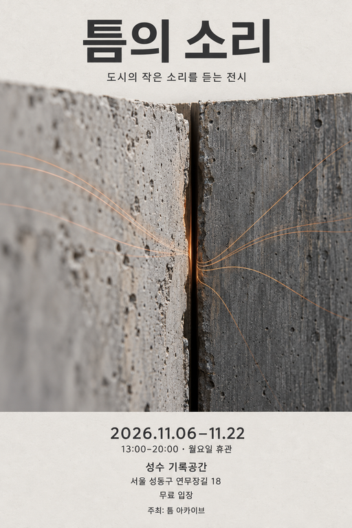
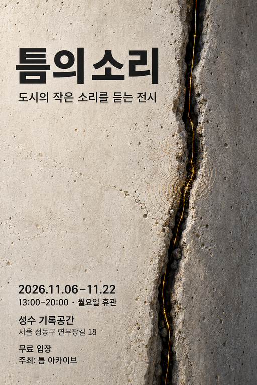
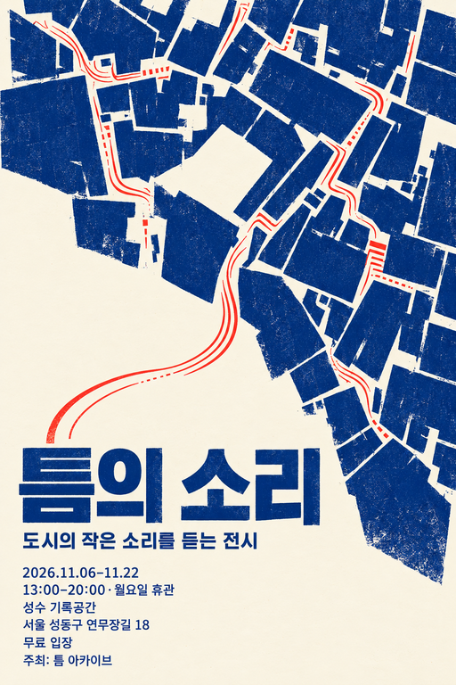
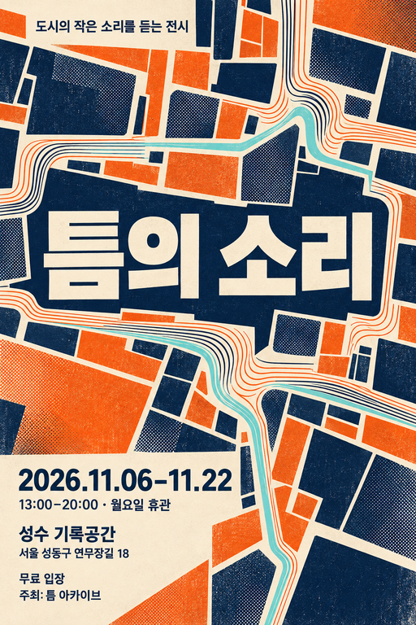

# 덕테이프 포스터 개선 평가

2026-10-07. 가상 요청으로 실제 이미지를 제작하고, 제작자와 평가자를 분리해 스킬을 개선했다. **첫 개선본은 두 독립 평가자가 기존 스킬보다 선호했다. 후속 보정은 일부 개선과 퇴행이 함께 나타났다. 모든 결과가 하이엔드 수준이거나 AI 슬롭이 없다고 인증하지 않는다.**

## 반영한 변경

- 주제에 특화된 발상을 이미지·글자·여백·읽는 순서의 구체적인 관계로 설계한다.
- 한글 획·어절·계층·대비와 재질·빛·경계를 축소, 화면 사용 크기, 원본에서 확인한다.
- AI 슬롭 방지를 독립 기준으로 둔다. 상투적 효과 조합, 가짜 미세 문자, 붙여 놓은 글자, 무차별 질감, 제작 논리의 혼란을 위치와 원인으로 지적한다. 특정 색이나 장르를 금지하지 않는다.
- 하이엔드·자료 조사 요청에서는 실제 작품과 1차 자료의 원리를 확인한다. [디자인·GitHub 자료와 적용 범위](../../skills/ducttape-poster/references/visual-research.md)를 기록했다. 원작 이미지는 출력 자산으로 포함하지 않았다.
- 보정 전후를 비교해 더 좋은 이전 결과를 유지할 수 있게 했다. 부분 수정에서 다른 문구뿐 아니라 빛·질감·구도의 변화를 확인한다.
- 기본 다섯 독립 이미지, 명시한 수량·비율·스타일 우선, 이미지당 최대 두 번 보정, 지정한 이미지의 후속 수정이라는 기존 동작을 유지했다.

## 실행 범위

[cases.yaml](cases.yaml)의 세 신규 제작 요청과 한 날짜 수정 요청을 사용했다. 표시 카피와 행사 정보는 모두 평가용 가상 입력이다. 내장 이미지 도구를 **20회 실제 호출**했다: 신규 생성 13회, 자동 보정 6회, 사용자가 지정하는 후속 날짜 수정 1회에 해당한다. 보정도 각각 실제 출력이 있으며 계획만 수행한 실행과 구별했다.

| 실행 | 신규 생성 | 자동 보정 | 후속 수정 | 해당 실행의 최종 수량 |
| --- | ---: | ---: | ---: | ---: |
| 원본 스킬 · 소리 전시 | 2 | 0 | 0 | 2 |
| 개선 1 · 같은 소리 전시 | 2 | 0 | 0 | 2 |
| 개선 1 · 제목만 있는 흑백 기본 제작 | 5 | 0 | 0 | 5 |
| 개선 2 · 같은 소리 전시 | 2 | 2 | 0 | 2 |
| 흑백 중 두 시안의 부분 보정 | 0 | 3 | 0 | 기존 다섯 장 중 두 방향 |
| 개선 2 · 긴 한글·손그림·두 비율 | 2 | 0 | 0 | 2 |
| 전시 이미지 한 장의 날짜 수정 | 0 | 1 | 1 | 1 |
| 합계 | 13 | 6 | 1 | 버전 비교 수량이며 하나의 제작 요청이 아님 |

세로 원본은 1024×1536, 정사각 원본은 1254×1254다. 최대 해상도를 프롬프트로 요청했지만 도구에 크기 설정 인자가 없어 최대 크기 달성이나 인쇄 적합성을 확인하지 않았다. 아래 미리보기는 비교용 축소본이다. 리사이즈를 생성 해상도로 세지 않았다.

## 독립 평가와 결과

버전·프롬프트·제작자 설명을 숨긴 이미지 식별자와 동일 원문을 평가자에게 제공했다. 실제 원본과 축소 이미지를 보았다. 1은 미해결, 3은 기능하는 결과, 5는 매우 잘 해결된 결과다. 항목별 근거를 기록하며 총점으로 문구·조건 위반을 상쇄하지 않았다. AI 슬롭 점수는 보이는 완성도에 대한 판단이며 제작 주체 판별이 아니다.

| 평가 | 공개 후 확인한 매핑 | 판단과 한계 |
| --- | --- | --- |
| [블라인드 1 · 디자인](review-design-round1.md) | A1=개선 1 지도, A2=개선 1 콘크리트; B1=원본 콘크리트, B2=원본 지도 | 개선 1 선호, 확신 중간. 글자·이미지 통합과 안내 계층 개선. AI 슬롭 점수 A1/A2=4/3, B1/B2=2/3. 금빛 신호 등 익숙한 표현은 남음. |
| [블라인드 1 · 별도 평가자](review-independent-round1.md) | 위와 동일 | 개선 1 선호, 확신 중간. 원본 지도는 개별 구성에서 강점. AI 슬롭 점수 A1/A2=4/4, B1/B2=3/4. 첫 평가자와 세부 판단 차이를 유지함. |
| [블라인드 2](review-design-round2.md) | C1=개선 2 콘크리트, C2=두 번째 보정 전 개선 2 그래픽; D1=개선 1 지도, D2=개선 1 콘크리트 | 개선 1을 근소하게 선호. C1의 틈을 활용한 글자 배치는 좋지만 C2의 범용 음악 포스터 문법·균일 질감은 약점. C1/C2 AI 슬롭=4/3. |
| [최종 시안의 마지막 보정 확인](review-final-targeted.md) | 새 개선 2 시안과 바로 이전 시안, 같은 쌍의 콘크리트 비교 | 재질 3→4지만 주제 연결 3→2, 글자·AI 슬롭 방지 모두 3. 제작자는 새 결과를 선호했지만 독립 평가와 최종 판단은 이전 결과를 선택했다. 새 블라인드 실험이 아닌 사후 확인이다. |
| [흑백·긴 한글·날짜 수정 평가](review-portfolio.md) | E1/E2/E4=개선 1 흑백, E3/E5=개선 2 보정; F1/F2=긴 카피; G=날짜 수정 전/첫 수정 | 아래 사례별 결과 참고. |
| [날짜 수정의 보정 전후 확인](review-date-edit-final.md) | 날짜 수정 두 결과와 원본 | 두 결과 모두 카피·큰 구도를 보존했지만 질감 보존은 부분 충족. 원본에 조금 더 가까운 첫 결과 선택. |

블라인드 2의 초기 평가자가 요청하지 않은 캠페인 가족 유사성을 평가에 넣었다. 서로 다른 독립 대안이라는 범위를 바로잡았고, [초기 보고서](review-design-round2-initial.md)와 수정 보고서를 모두 보존했다. 수정 후에도 개별 결과의 약점에 근거한 선호는 동일했다.

## 주요 비교 이미지

| 기존 스킬 | 개선 1 |
| --- | --- |
|  |  |
|  |  |

개선 2의 최종 선택은 [콘크리트](previews/v2-main-01.png)와 [그래픽 결과](previews/v2-main-02.png)다. 블라인드 2의 C2와 같은 파일이다. 이후 만든 **[종이 가장자리 보정](previews/v2-main-02-after-repair2.png)**은 재질의 이득보다 주제의 퇴행이 커 채택하지 않았다. 서로 다른 결과의 점수를 옮기지 않는다.

## 다른 요청과 보정의 퇴행

**기본 다섯 장:** 수량을 생략한 제목 입력에서 실제로 서로 다른 흑백 2:3 이미지 다섯 장이 나왔다. 추가 카피·실제 책 표지·로고는 관찰되지 않았다. 종이 접힘, 압인, 망점, 절단, 인쇄라는 방향 차이가 있으나 일반적인 종이 표현과 목업처럼 보일 수 있는 경계 등 일부 한계가 남았다. 마지막 스킬의 새 다섯 장 전체 배치를 재실행한 결과는 아니다.

**망점 보정:** 제목을 망점에 더 통합한 [보정 결과](previews/v2-sparse-03.png)는 마지막 어절의 대비를 떨어뜨렸다. 독립 평가에서 타이포그래피 2, AI 슬롭 방지 3을 받았고 [이전 결과](previews/v1-sparse-03.png)가 더 읽히므로 이전 결과를 선택했다. 세부 보정의 개선을 전체 개선으로 오인하지 않도록 스킬에 회귀 비교를 추가했다. [인쇄 롤러 보정](previews/v2-sparse-05.png)은 주제의 행동을 더 드러냈지만 질감의 과잉으로 AI 슬롭 방지 3이 남았다. 최종 흑백 선택은 1·2·3·4 원본과 5 보정본의 다섯 장이며, 보정 파일을 별도 스타일로 세지 않는다.

**긴 한글과 조건:** 노랑·파랑의 따뜻한 손그림이라는 공통 조건 안에서 [세로 수선 천](previews/dense-portrait.png)과 [정사각 토스터 수리](previews/dense-square.png)를 만들었다. 실제 최종 수량은 두 장이고 비율 조합으로 네 장을 만들지 않았다. 두 결과의 전체 여덟 문구를 제작자와 독립 평가자가 원본에서 확인했다. 비용·수리 보장·마지막 접수 안내도 보존됐다. 독립 평가의 내용·글자·마감·AI 슬롭 방지 항목은 각각 4였다.

**날짜만 수정:** [첫 결과](previews/date-edit.png)의 날짜 `2026.12.04–12.20`과 나머지 문구·큰 배치는 확인됐지만, 원본과 다른 질감이 생겼다. [추가 보정](previews/date-edit-repair2.png)도 해결하지 못해 독립 평가에서 원본에 조금 더 가까운 첫 결과를 선택했다. 날짜 영역을 제외한 RGB 평균 차이는 첫 결과 약 3.42%, 추가 보정 약 3.65%였다. 이는 255 대비 픽셀 차이 진단이며 의미·구도가 그 비율만큼 바뀌었다는 뜻은 아니다. 엄격한 표면 보존을 통과했다고 말하지 않는다.

## 증거와 검증 범위

[evidence.json](evidence.json)에 선택 결과·비교 결과의 원본 해시, 실제 픽셀 크기, 축소본과 버전 해시를 기록했다. [원본 스킬](snapshots/baseline/SKILL.md), [개선 1](snapshots/v1/SKILL.md), [개선 2](snapshots/v2/SKILL.md)의 지침과 참조 문서 사본을 함께 보존했다. 현재 지침은 [실제 스킬](../../skills/ducttape-poster/SKILL.md)에 있다.

전체 원본 PNG, 내부 제작 명세, 도구 실행 내역, 채택·폐기 이력은 로컬 `ducttape-poster-evaluation/` 폴더에 있으며, 저장소에는 축소 비교 이미지와 평가를 포함했다. 모델 출력은 비결정적이므로 같은 요청의 재실행이 같은 이미지를 보장하지 않는다.

최종 지침의 회귀 비교·대비·부분 수정 보존 규칙은 이번 실제 보정 사례를 근거로 추가했고 마지막 보정에 적용했다. 최종 버전의 모든 사례를 새로 생성해 반복 검증하지 않았다. 실제 로고·화면 재현, 다른 행사 정보가 있는 외부 참조의 치환은 지침 확인만 했으며 이번에 실제 생성으로 시험하지 않았다.

스킬 구조 검사, YAML 읽기, 상대 링크·증거 파일·해시·이미지 크기 확인, `git diff --check`를 수행했다. 이 검증과 시각 평가는 위의 실제 범위에 한정한다.
